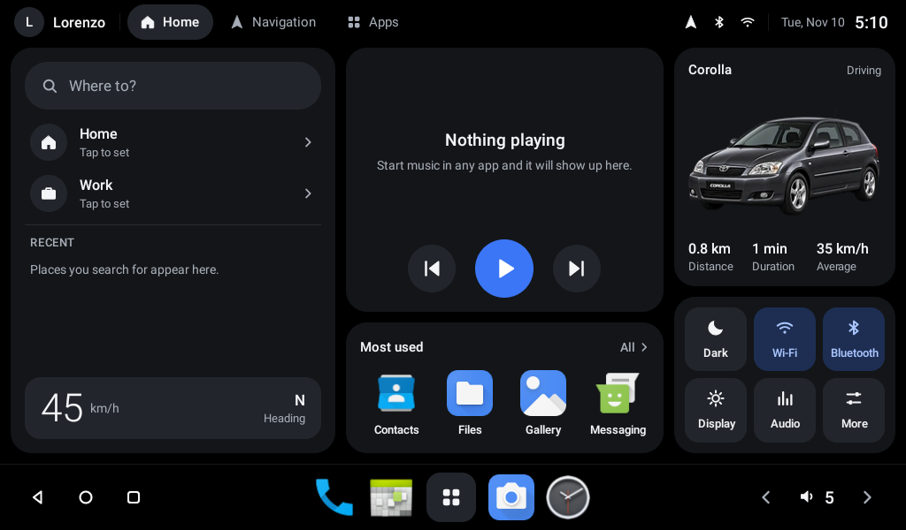

# Corolla Launcher

A clean, car-first Android home screen for an aftermarket head unit. Built for a Podofo
Android unit in a 2005 Toyota Corolla E120, but nothing in the code is specific to that car:
it should run on any landscape Android head unit.

| Dark (default) | Light |
| --- | --- |
|  |  |

> **Status: 0.2.0, tested on an emulator only.** The app has not run on the real head unit
> yet. See [Known limits](#known-limits) and [docs/head-unit.md](docs/head-unit.md).

## What it does

- **Dashboard home screen** made of cards, full screen, with the system bars hidden:
  - **Top bar**: your name (configurable), tabs for Home, Navigation (opens the maps app) and
    Apps, then GPS, Bluetooth and network status, date and time.
  - **Navigation card**: "Where to?" search, Home and Work, the last two places searched, and
    the current **speed and heading** from GPS.
  - **Media card** that follows whatever is playing. Every app with an active media session
    (Spotify, YouTube Music, a podcast app...) appears as a chip; tap one to switch source.
    Title, artist, cover and progress; play/pause/next/previous always work.
  - **Most used**: the four apps you launch most, with their real icons.
  - **Car card**: a photo of the Corolla and a **trip computer** (distance, duration, average
    speed) measured from GPS. A trip ends after 20 minutes standing still.
  - **Quick settings**: theme, Wi-Fi, Bluetooth, display, audio (equalizer) and Settings.
  - **Bottom bar**: Back, Home and Recent apps on the left, four docked apps around the All apps
    button, volume on the right.
- **All apps** grid with search. Long press an app to pin it to the bottom bar or open its
  system info.
- **Light and dark themes**, always uniform: all black or all white, never mixed. Dark by
  default, with manual, follow-system and time-based modes.
- **Five languages**: English, Italian, German, Spanish, French. Switch in Settings, on any
  Android version.
- **Light animations, no touch sounds.** Buttons react to the press, screens and dock icons
  ease in, the player fades between tracks. Only GPU-composited properties are animated, and
  *Settings → Animations* turns all of it off on a unit that cannot keep up. The app never
  plays a click sound.

## Requirements

- Android 7.0 (API 24) or newer on the device.
- To build: JDK 17 or 21, and the Android SDK with platform `android-37.2`.
  The Gradle wrapper downloads Gradle 9.8.1 itself.

## Build

```bash
./gradlew :app:assembleDebug
```

The APK lands in `app/build/outputs/apk/debug/app-debug.apk`. If your default `java` is newer
than 21, point `JAVA_HOME` at a JDK 17 or 21 first.

Other useful commands:

```bash
./gradlew :app:testDebugUnitTest      # unit tests
python3 scripts/check_translations.py # every language has every string
./gradlew :app:assembleRelease        # minified build, debug-signed unless keystore.properties exists
```

## Try it on an emulator

`scripts/emulator.sh` creates an emulator shaped like the head unit (1024x600, 160 dpi):

```bash
scripts/emulator.sh create   # once; needs the "system-images;android-30;default;x86_64" image
scripts/emulator.sh window   # boot with a visible window (use "start" for headless)
adb -e install -r app/build/outputs/apk/debug/app-debug.apk
```

## Install on the head unit

1. Enable developer options and USB or Wi-Fi debugging on the unit, then connect with `adb`.
2. Install: `adb install -r app/build/outputs/apk/debug/app-debug.apk`
3. Press Home and choose **Corolla Launcher**, or open *Settings → Default launcher* in the app.
   Some units hide this choice; see [docs/head-unit.md](docs/head-unit.md) for workarounds.
4. Tap the speed or car card once and allow location, so speed and trip work. The app never
   asks on its own. Over adb: `adb shell pm grant <package> android.permission.ACCESS_FINE_LOCATION`.
5. Allow media access so the player can see what is playing. Either tap **Allow access** on the
   home screen, or grant it over adb:

   ```bash
   adb shell cmd notification allow_listener \
     io.github.giannoccarol.corollalauncher.debug/io.github.giannoccarol.corollalauncher.media.MediaListenerService
   ```

   Drop `.debug` from the package name for release builds.
6. To make the **Recent apps** key work, enable *Corolla Launcher* under the system
   Accessibility settings (the app explains this the first time you tap the key), or over adb:

   ```bash
   adb shell settings put secure enabled_accessibility_services \
     io.github.giannoccarol.corollalauncher.debug/io.github.giannoccarol.corollalauncher.keys.NavKeyService
   adb shell settings put secure accessibility_enabled 1
   ```

   The adb command replaces any accessibility service already enabled on the device. The
   service only sends Back, Home and Recents: it subscribes to no events and cannot read
   screen content.

## Using it

| Action | How |
| --- | --- |
| Set your name | Tap the name at the top left, or *Settings → Your name* |
| Open an app | Tap its icon in the bottom bar, in **Most used** or in **All apps** |
| See recent apps | Square key, bottom left (needs the accessibility service, see above) |
| Show the system bars | Swipe in from the top or bottom edge; they hide again by themselves |
| Pin or unpin a bottom bar app | Long press the icon |
| Turn on speed and trip | Tap the speed or car card and allow location |
| Switch media source | Tap the app chip at the top of the player |
| Set Home / Work address | Long press the row, or *Settings → Navigation* |
| Switch theme | The theme tile in quick settings, or *Settings → Theme* for all modes |
| Change language | *Settings → Language* |
| Turn animations off | *Settings → Animations* |

## Known limits

- **Not yet run on the real head unit.** Everything below was verified on the emulator only.
- **The media player with a live session is untested.** The empty and "allow access" states
  were checked; the playing state could not be, because the emulator image has no music app.
- **Stock radio and Bluetooth apps may not show up in the player.** Many head units play
  radio and Bluetooth audio without a media session, which makes them invisible to any
  third-party app. The transport buttons still send media key presses.
- **Volume buttons may do nothing on some units**, where the amplifier is driven by the
  unit's own controller instead of Android's volume.
- **Notification access can be unavailable** on low-RAM Android 8 builds. The player then
  stays in its fallback mode.
- **Back and Home do nothing on the home screen itself.** There is nowhere to go back to and
  you are already home. They are there so the keys keep their place; Recent apps is the one
  that acts.
- **The Bluetooth icon means "Bluetooth is on"**, not "a phone is connected". Showing the
  connection would need a runtime permission the app currently avoids.
- **Speed and trip come from the unit's GPS antenna** and were tested only with simulated
  fixes. Many head units have a weak antenna; the app shows "Waiting for GPS" until a fix
  arrives. The trip restarts if the app process is restarted.
- **A small notification stays while location is on** ("Trip computer on"). Android requires
  it for apps that read GPS in the background; it is silent and low priority.
- **Wi-Fi and Bluetooth tiles switch directly only on Android 9 and 11 or below**
  respectively. On newer versions Android forbids it, and the tile opens the system panel.
- **The Audio tile opens the system equalizer**, which head units often replace with their own
  DSP app; that app's package is still unknown (see [docs/head-unit.md](docs/head-unit.md)).
- **Hiding the system bar is untested on the unit.** Some firmwares draw their bar as an
  overlay that an app cannot hide.
- **Animation smoothness is unmeasured on real hardware.** They are built to be cheap, but if
  they stutter on the unit, turn them off in Settings.
- **The unit may still beep on touch.** The app's own click sounds are off, but many head
  units have a separate system-wide touch beep in their own settings, which no app can mute.

## Project layout

```
app/src/main/java/.../corollalauncher/
  LauncherApp.kt          process setup: theme, package change listener
  home/                   the home screen
  apps/                   app list, dock selection, icons, app drawer
  media/                  media session tracking and media key fallback
  status/                 the launcher's own status bar
  trip/                   GPS speed, heading and trip computer, foreground service
  keys/                   accessibility service behind the dock's system keys
  nav/                    navigation intents, recent destinations
  settings/               preferences, languages, settings screen
  theme/                  light/dark handling
  ui/                     base activity, full-screen handling, text dialog, motion
app/src/main/res/
  values/ values-night/   light and dark colors (same names in both)
  values-xx/              translations
docs/                     architecture, design tokens, head unit notes
art/                      source artwork (the original car photo)
scripts/                  translation check, emulator helper
.claude/                  skills and agents for AI coding assistants
```

More detail in [docs/architecture.md](docs/architecture.md) and
[docs/design.md](docs/design.md).

## Working on it with an AI assistant

[AGENTS.md](AGENTS.md) holds the rules an assistant must follow in this repo (it is also
loaded by Claude Code through `CLAUDE.md`). `.claude/skills/` has step-by-step procedures for
building and installing, adding a language, and probing the head unit; `.claude/agents/` has
two reviewers for head unit constraints and translations.

## Roadmap

- A live map in the navigation card (see the discussion in [docs/head-unit.md](docs/head-unit.md)).
- Turn-by-turn hints read from the navigation app's notification.
- Configurable cards: choose and arrange them (weather, radio presets).
- Accent color and night hours in Settings.
- Theme switching from the headlight signal, if the unit exposes it.
- Launching the stock radio, Bluetooth and reverse camera apps by name once their package
  names are known.

## Credits

- [AndroidX](https://developer.android.com/jetpack/androidx) (AppCompat, Core KTX,
  RecyclerView) by Google and the Android Open Source Project, Apache License 2.0.
- Build tooling: [Gradle](https://gradle.org) and the Android Gradle Plugin.
- Icons in the app are drawn for this project. App icons shown at runtime belong to their
  respective apps and are read from the device, not bundled.
- The layout takes general inspiration from modern in-car interfaces (card dashboard, large
  type, bottom bar, uniform light and dark themes). No third-party code, artwork or fonts were
  copied.
- The Toyota Corolla E120 photo (`art/corolla-e120.png`, resized into
  `res/drawable-*/car_corolla.webp`) was supplied by the owner of this project; its original
  source is not recorded. Toyota and Corolla are trademarks of Toyota Motor Corporation.
  Replace the photo before making the repository or the app public.

## License

Private project, all rights reserved. No license is granted.
